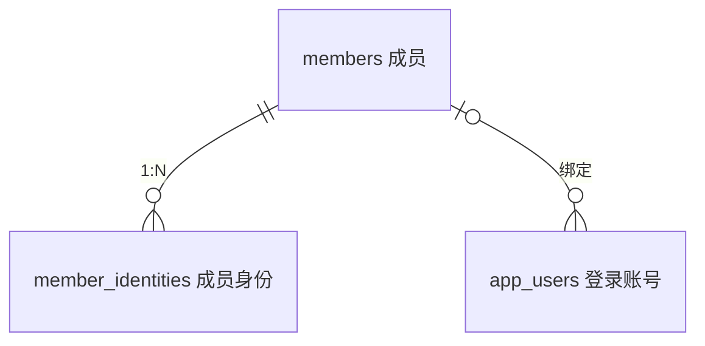
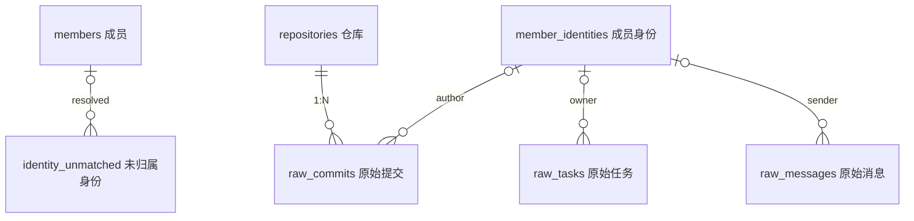
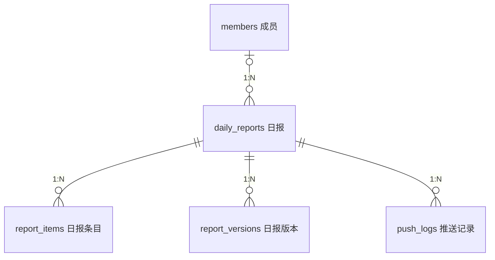
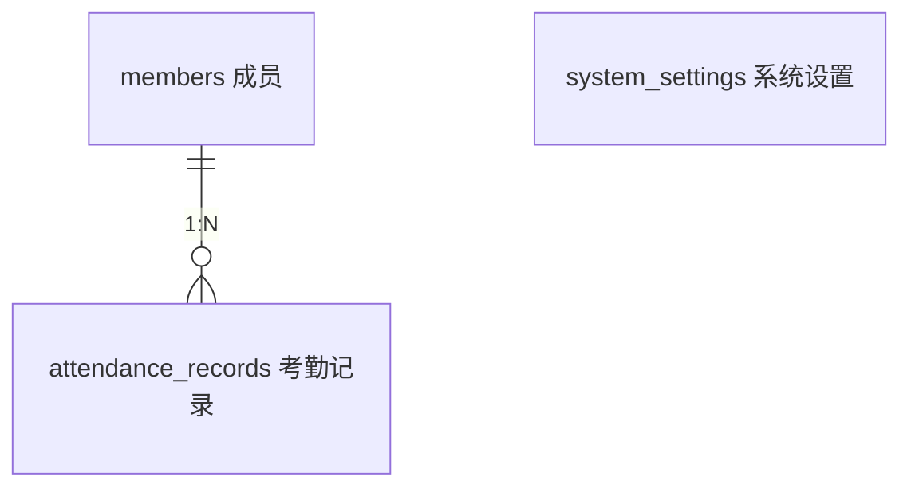

# v1 数据库 ER 图与表结构

> 数据库：`daily_report` @ `127.0.0.1:3305`
> 建表脚本：[../backend/sql/schema.sql](../backend/sql/schema.sql)
> 表数量：**17 张**
> 说明：ER 图只画**表名（中英文）与关系**，不画字段；字段详情见第 2 节。

## 1. ER 图

### 1.1 成员与权限

### 1.2 采集与原始数据

### 1.3 日报与推送

### 1.4 考勤与系统设置

### 1.5 运维与数据源配置

## 2. 表结构详情

### 2.1 成员与权限

#### members 成员

| 字段 | 类型 | 约束 / 默认 | 说明 |
|------|------|-------------|------|
| id | BIGINT UNSIGNED | PK, AUTO_INCREMENT | 主键 |
| name | VARCHAR(64) | NOT NULL | 姓名 |
| email | VARCHAR(255) | NOT NULL, UNIQUE | 邮箱，唯一 |
| role | ENUM('member','leader','mentor') | NOT NULL, DEFAULT 'member' | 角色 |
| status | ENUM('active','inactive') | NOT NULL, DEFAULT 'active' | 状态 |
| created_at | DATETIME | NOT NULL, DEFAULT CURRENT_TIMESTAMP | 创建时间 |
| updated_at | DATETIME | NOT NULL, ON UPDATE CURRENT_TIMESTAMP | 更新时间 |

索引：`uk_members_email(email)`。

#### member_identities 成员身份

| 字段 | 类型 | 约束 / 默认 | 说明 |
|------|------|-------------|------|
| id | BIGINT UNSIGNED | PK, AUTO_INCREMENT | 主键 |
| member_id | BIGINT UNSIGNED | NOT NULL, FK → members.id | 所属成员 |
| provider | ENUM('github','feishu') | NOT NULL | 平台 |
| external_id | VARCHAR(128) | NOT NULL | 平台内唯一 ID |
| external_username | VARCHAR(128) | NULL | 平台用户名 |
| verified | TINYINT(1) | NOT NULL, DEFAULT 0 | 是否人工确认 |
| created_at | DATETIME | NOT NULL, DEFAULT CURRENT_TIMESTAMP | 创建时间 |

索引：`uk_provider_external(provider, external_id)`、`idx_identity_member(member_id)`。

#### app_users 登录账号

| 字段 | 类型 | 约束 / 默认 | 说明 |
|------|------|-------------|------|
| id | BIGINT UNSIGNED | PK, AUTO_INCREMENT | 主键 |
| username | VARCHAR(64) | NOT NULL, UNIQUE | 登录名 |
| password_hash | VARCHAR(255) | NOT NULL | PBKDF2 哈希 |
| role | ENUM('admin','leader','member') | NOT NULL, DEFAULT 'member' | 系统角色 |
| member_id | BIGINT UNSIGNED | NULL, FK → members.id | 绑定的成员 |
| active | TINYINT(1) | NOT NULL, DEFAULT 1 | 是否启用 |
| created_at | DATETIME | NOT NULL, DEFAULT CURRENT_TIMESTAMP | 创建时间 |
| updated_at | DATETIME | NOT NULL, ON UPDATE CURRENT_TIMESTAMP | 更新时间 |

索引：`uk_app_user_username(username)`。

### 2.2 采集与原始数据

#### repositories 仓库

| 字段 | 类型 | 约束 / 默认 | 说明 |
|------|------|-------------|------|
| id | BIGINT UNSIGNED | PK, AUTO_INCREMENT | 主键 |
| owner | VARCHAR(128) | NOT NULL | 仓库 owner |
| name | VARCHAR(128) | NOT NULL | 仓库名 |
| default_branch | VARCHAR(128) | NOT NULL, DEFAULT 'main' | 默认分支 |
| enabled | TINYINT(1) | NOT NULL, DEFAULT 1 | 是否启用采集 |
| created_at | DATETIME | NOT NULL, DEFAULT CURRENT_TIMESTAMP | 创建时间 |

索引：`uk_repo(owner, name)`。

#### raw_commits 原始提交

| 字段 | 类型 | 约束 / 默认 | 说明 |
|------|------|-------------|------|
| id | BIGINT UNSIGNED | PK, AUTO_INCREMENT | 主键 |
| repo_id | BIGINT UNSIGNED | NOT NULL, FK → repositories.id | 仓库 |
| sha | CHAR(40) | NOT NULL | 提交 SHA |
| author_identity_id | BIGINT UNSIGNED | NULL, FK → member_identities.id | 作者身份 |
| author_name | VARCHAR(128) | NOT NULL | 作者名 |
| author_email | VARCHAR(255) | NULL | 作者邮箱 |
| committed_at | DATETIME | NOT NULL | 提交时间 |
| message | TEXT | NOT NULL | 提交说明 |
| branch | VARCHAR(128) | NULL | 分支 |
| url | VARCHAR(512) | NULL | 提交链接 |
| pr_number | INT | NULL | 关联 PR |
| collected_at | DATETIME | NOT NULL, DEFAULT CURRENT_TIMESTAMP | 采集时间 |

索引：`uk_repo_sha(repo_id, sha)`、`idx_commit_time(committed_at)`、`idx_commit_author(author_identity_id)`。

#### raw_tasks 原始任务

| 字段 | 类型 | 约束 / 默认 | 说明 |
|------|------|-------------|------|
| id | BIGINT UNSIGNED | PK, AUTO_INCREMENT | 主键 |
| task_id | VARCHAR(128) | NOT NULL, UNIQUE | 飞书任务 ID |
| title | VARCHAR(512) | NOT NULL | 任务标题 |
| owner_identity_id | BIGINT UNSIGNED | NULL, FK → member_identities.id | 负责人身份 |
| participants_json | JSON | NULL | 参与人列表 |
| status | VARCHAR(64) | NOT NULL, DEFAULT 'open' | 任务状态 |
| status_changed_at | DATETIME | NULL | 状态变更时间 |
| created_at_source | DATETIME | NULL | 源创建时间 |
| updated_at_source | DATETIME | NULL | 源更新时间 |
| collected_at | DATETIME | NOT NULL, DEFAULT CURRENT_TIMESTAMP | 采集时间 |

索引：`uk_task_id(task_id)`、`idx_task_owner(owner_identity_id)`、`idx_task_time(status_changed_at)`。

#### raw_messages 原始消息

| 字段 | 类型 | 约束 / 默认 | 说明 |
|------|------|-------------|------|
| id | BIGINT UNSIGNED | PK, AUTO_INCREMENT | 主键 |
| message_id | VARCHAR(128) | NOT NULL, UNIQUE | 飞书消息 ID |
| chat_id | VARCHAR(128) | NOT NULL | 群 ID |
| sender_identity_id | BIGINT UNSIGNED | NULL, FK → member_identities.id | 发送人身份 |
| sender_name | VARCHAR(128) | NULL | 发送人名称 |
| sent_at | DATETIME | NOT NULL | 发送时间 |
| content_excerpt | TEXT | NULL | 截断后的摘要 |
| content_hash | CHAR(64) | NULL | 内容哈希 |
| collected_at | DATETIME | NOT NULL, DEFAULT CURRENT_TIMESTAMP | 采集时间 |

索引：`uk_message_id(message_id)`、`idx_chat_sent(chat_id, sent_at)`、`idx_message_sender(sender_identity_id)`。

#### identity_unmatched 未归属身份

| 字段 | 类型 | 约束 / 默认 | 说明 |
|------|------|-------------|------|
| id | BIGINT UNSIGNED | PK, AUTO_INCREMENT | 主键 |
| provider | ENUM('github','feishu') | NOT NULL | 平台 |
| external_id | VARCHAR(128) | NOT NULL | 平台内 ID |
| external_name | VARCHAR(128) | NULL | 平台内名称 |
| source_type | VARCHAR(32) | NOT NULL | 来源类型（commit/task/message/attendance） |
| source_id | VARCHAR(128) | NOT NULL | 来源记录 ID |
| resolved_member_id | BIGINT UNSIGNED | NULL, FK → members.id | 人工绑定后的成员 |
| resolved_at | DATETIME | NULL | 绑定时间 |
| created_at | DATETIME | NOT NULL, DEFAULT CURRENT_TIMESTAMP | 创建时间 |

索引：`uk_unmatched(provider, external_id, source_type, source_id)`。

### 2.3 日报与推送

#### daily_reports 日报

| 字段 | 类型 | 约束 / 默认 | 说明 |
|------|------|-------------|------|
| id | BIGINT UNSIGNED | PK, AUTO_INCREMENT | 主键 |
| report_date | DATE | NOT NULL | 日报日期 |
| report_type | ENUM('personal','team') | NOT NULL | 个人 / 团队 |
| scope_key | VARCHAR(64) | NOT NULL | 个人 `member:{id}`，团队 `team` |
| member_id | BIGINT UNSIGNED | NULL, FK → members.id | 个人日报成员 |
| status | ENUM('draft','generated','published') | NOT NULL, DEFAULT 'generated' | 状态 |
| current_version | INT | NOT NULL, DEFAULT 1 | 当前版本 |
| content_md | MEDIUMTEXT | NOT NULL | Markdown 正文 |
| summary_json | JSON | NULL | 统计摘要 |
| generated_at | DATETIME | NOT NULL, DEFAULT CURRENT_TIMESTAMP | 生成时间 |
| updated_at | DATETIME | NOT NULL, ON UPDATE CURRENT_TIMESTAMP | 更新时间 |

索引：`uk_report_scope(report_date, report_type, scope_key)`、`idx_report_date(report_date)`、`idx_report_member(member_id)`。

#### report_items 日报条目

| 字段 | 类型 | 约束 / 默认 | 说明 |
|------|------|-------------|------|
| id | BIGINT UNSIGNED | PK, AUTO_INCREMENT | 主键 |
| report_id | BIGINT UNSIGNED | NOT NULL, FK → daily_reports.id, ON DELETE CASCADE | 日报 |
| category | ENUM('commit','task','message','collaboration','manual') | NOT NULL | 条目类型 |
| title | VARCHAR(512) | NOT NULL | 条目标题 |
| detail | TEXT | NULL | 详情 |
| source_type | VARCHAR(32) | NULL | 原始数据类型 |
| source_id | VARCHAR(128) | NULL | 原始数据 ID |
| attribution_role | ENUM('author','reviewer','assignee','participant','owner') | NULL | 归属角色 |
| sort_order | INT | NOT NULL, DEFAULT 0 | 排序 |
| created_at | DATETIME | NOT NULL, DEFAULT CURRENT_TIMESTAMP | 创建时间 |

索引：`idx_item_report(report_id)`、`idx_item_source(source_type, source_id)`。

#### report_versions 日报版本

| 字段 | 类型 | 约束 / 默认 | 说明 |
|------|------|-------------|------|
| id | BIGINT UNSIGNED | PK, AUTO_INCREMENT | 主键 |
| report_id | BIGINT UNSIGNED | NOT NULL, FK → daily_reports.id, ON DELETE CASCADE | 日报 |
| version | INT | NOT NULL | 版本号 |
| content_md | MEDIUMTEXT | NOT NULL | 该版本正文 |
| editor | VARCHAR(64) | NOT NULL | 编辑者 |
| change_note | VARCHAR(255) | NULL | 变更说明 |
| created_at | DATETIME | NOT NULL, DEFAULT CURRENT_TIMESTAMP | 创建时间 |

索引：`uk_report_version(report_id, version)`。

#### push_logs 推送记录

| 字段 | 类型 | 约束 / 默认 | 说明 |
|------|------|-------------|------|
| id | BIGINT UNSIGNED | PK, AUTO_INCREMENT | 主键 |
| report_id | BIGINT UNSIGNED | NOT NULL, FK → daily_reports.id, ON DELETE CASCADE | 日报 |
| channel | ENUM('email','feishu','console') | NOT NULL | 渠道 |
| target | VARCHAR(255) | NOT NULL | 目标 |
| status | ENUM('success','failed') | NOT NULL | 结果 |
| attempt | INT | NOT NULL, DEFAULT 1 | 第几次尝试 |
| error_message | VARCHAR(1024) | NULL | 错误信息 |
| sent_at | DATETIME | NOT NULL, DEFAULT CURRENT_TIMESTAMP | 发送时间 |

索引：`idx_push_report(report_id)`、`idx_push_status(status, sent_at)`。

### 2.4 考勤与设置

#### attendance_records 考勤记录（v1 的 Mock 版）

| 字段 | 类型 | 约束 / 默认 | 说明 |
|------|------|-------------|------|
| id | BIGINT UNSIGNED | PK, AUTO_INCREMENT | 主键 |
| member_id | BIGINT UNSIGNED | NOT NULL, FK → members.id | 成员 |
| work_date | DATE | NOT NULL | 工作日期 |
| check_in | DATETIME | NULL | 上班时间 |
| check_out | DATETIME | NULL | 下班时间 |
| status | VARCHAR(16) | NOT NULL, DEFAULT 'normal' | 状态 |
| late_minutes | INT | NOT NULL, DEFAULT 0 | 迟到分钟 |
| early_minutes | INT | NOT NULL, DEFAULT 0 | 早退分钟 |
| source | VARCHAR(16) | NOT NULL, DEFAULT 'mock' | 来源 |
| raw_json | JSON | NULL | 原始数据 |
| created_at | DATETIME | NOT NULL, DEFAULT CURRENT_TIMESTAMP | 创建时间 |

索引：`uk_attendance_member_date(member_id, work_date)`、`idx_attendance_date(work_date)`。

#### system_settings 系统设置

| 字段 | 类型 | 约束 / 默认 | 说明 |
|------|------|-------------|------|
| key | VARCHAR(64) | PK | 设置键 |
| value | TEXT | NOT NULL | 设置值 |
| updated_at | DATETIME | NOT NULL, ON UPDATE CURRENT_TIMESTAMP | 更新时间 |

### 2.5 运维与数据源配置

#### source_sync_state 数据源同步状态

| 字段 | 类型 | 约束 / 默认 | 说明 |
|------|------|-------------|------|
| id | BIGINT UNSIGNED | PK, AUTO_INCREMENT | 主键 |
| source | ENUM('github','feishu_tasks','feishu_messages') | NOT NULL | 数据源 |
| resource_key | VARCHAR(191) | NOT NULL | 资源标识 |
| last_cursor | VARCHAR(255) | NULL | 增量游标 |
| last_synced_at | DATETIME | NULL | 最近同步时间 |
| status | ENUM('idle','running','success','partial','failed') | NOT NULL, DEFAULT 'idle' | 状态 |
| error_message | VARCHAR(1024) | NULL | 错误信息 |
| updated_at | DATETIME | NOT NULL, ON UPDATE CURRENT_TIMESTAMP | 更新时间 |

索引：`uk_source_resource(source, resource_key)`。

#### collection_runs 采集运行记录

| 字段 | 类型 | 约束 / 默认 | 说明 |
|------|------|-------------|------|
| id | BIGINT UNSIGNED | PK, AUTO_INCREMENT | 主键 |
| run_type | VARCHAR(16) | NOT NULL, DEFAULT 'daily' | 运行类型 |
| status | VARCHAR(16) | NOT NULL, DEFAULT 'running' | 运行状态 |
| started_at | DATETIME | NOT NULL, DEFAULT CURRENT_TIMESTAMP | 开始时间 |
| finished_at | DATETIME | NULL | 结束时间 |
| records_count | INT | NOT NULL, DEFAULT 0 | 记录数 |
| error_message | VARCHAR(1024) | NULL | 错误信息 |
| detail_json | JSON | NULL | 明细 |
| created_at | DATETIME | NOT NULL, DEFAULT CURRENT_TIMESTAMP | 创建时间 |

索引：`idx_run_started(started_at)`、`idx_run_status(status)`。

#### data_sources 数据源配置

| 字段 | 类型 | 约束 / 默认 | 说明 |
|------|------|-------------|------|
| id | BIGINT UNSIGNED | PK, AUTO_INCREMENT | 主键 |
| source | VARCHAR(32) | NOT NULL, UNIQUE | 数据源标识 |
| enabled | TINYINT(1) | NOT NULL, DEFAULT 1 | 是否启用 |
| config_json | JSON | NULL | 配置（不含密钥） |
| last_run_at | DATETIME | NULL | 最近运行时间 |
| last_status | VARCHAR(16) | NULL | 最近状态 |
| last_error | VARCHAR(1024) | NULL | 最近错误 |
| updated_at | DATETIME | NOT NULL, ON UPDATE CURRENT_TIMESTAMP | 更新时间 |

索引：`uk_data_source(source)`。
