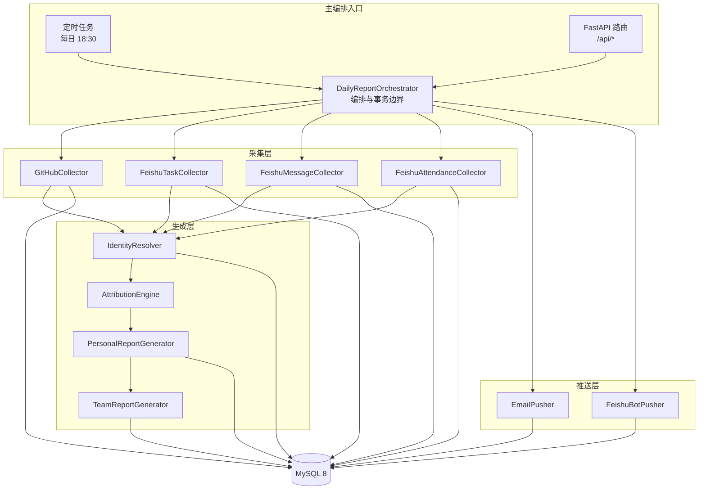

# 智能日报生成器 · 系统设计规范（design.md）

> 版本：v1.0
> 阶段：第 2 周 · 架构设计
> 关联：[proposal.md](proposal.md)
> 说明：需求编号 `S1–S9`、`IR-1–IR-10` 均引自 proposal.md；本文件的模块与表结构必须能逐条追溯。

## 1. 系统架构

### 1.1 分层架构图



文字说明：

- **采集层**只负责“把外部数据取回来并规范化”，不做归属判断；
- **生成层**负责身份解析、协作归属、个人日报与团队日报生成，全部是纯函数式处理（输入 → 输出），便于测试；
- **推送层**只负责投递与结果记录，不修改日报内容；
- **主编排入口**负责串联各层、控制事务与幂等，是唯一对外的调度/API 入口。

### 1.2 分层依赖原则

- 上层可以依赖下层，下层不得反向依赖上层；
- 采集层与推送层通过协议（Protocol）解耦，方便用 mock 替换真实接口；
- 生成层不直接访问网络，只消费采集层规范化后的数据。

## 2. 模块职责

| 模块 | 职责边界（一句话） | 对应需求 |
|------|--------------------|----------|
| `GitHubCollector` | 采集指定仓库时间窗口内的 commit 及 PR/issue 关联，按 `(repo_id, sha)` 幂等 | S1、IR-2 |
| `FeishuTaskCollector` | 采集飞书任务的创建与状态流转，按 `task_id` 幂等 | S2、IR-2 |
| `FeishuMessageCollector` | 采集指定群的成员发言，按 `message_id` 幂等 | S3、IR-2 |
| `FeishuAttendanceCollector` | 采集指定日期、成员的考勤状态与首末打卡时间，按 `(member_id, attendance_date)` 幂等 | S10、IR-11 |
| `IdentityResolver` | 把 GitHub/飞书身份映射到成员，未命中写入未归属表 | S4、IR-1 |
| `AttributionEngine` | 按角色规则把原始记录归属到成员，去重且不重复计数 | S5、IR-3 |
| `PersonalReportGenerator` | 按任务/模块归类生成个人日报，处理「无产出」 | S5、IR-5 |
| `TeamReportGenerator` | 汇总全组个人日报，去重并生成团队概览 | S6 |
| `EmailPusher` | 通过 SMTP 投递日报并记录结果 | S7、IR-8 |
| `FeishuBotPusher` | 通过飞书机器人投递日报并记录结果 | S7、IR-8 |
| `DailyReportOrchestrator` | 串联采集 → 生成 → 推送，控制事务、幂等与降级 | S1–S8、IR-10 |
| `FastAPI 路由` | 对外提供日报查询、编辑、生成、推送、身份绑定接口 | S8、S9 |
| `Vue 前端` | 查看/编辑日报、绑定未归属身份、查看推送状态 | S9 |

## 3. 数据模型

### 3.1 实体关系

ER 图见 [uml/er.puml](uml/er.puml)。核心实体：成员、成员身份、仓库、原始提交、原始任务、原始消息、未归属记录、日报、日报条目、日报版本、推送日志、同步状态。

### 3.2 MySQL 表结构

> 课程示例默认 SQLite，本项目按实际要求使用 MySQL 8（见 ADR-002）。所有表使用 `utf8mb4`，时间统一存 UTC，展示时转 Asia/Shanghai。

```sql
CREATE TABLE members (
  id BIGINT UNSIGNED AUTO_INCREMENT PRIMARY KEY,
  name VARCHAR(64) NOT NULL,
  email VARCHAR(255) NOT NULL,
  role ENUM('member','leader','mentor') NOT NULL DEFAULT 'member',
  status ENUM('active','inactive') NOT NULL DEFAULT 'active',
  created_at DATETIME NOT NULL DEFAULT CURRENT_TIMESTAMP,
  updated_at DATETIME NOT NULL DEFAULT CURRENT_TIMESTAMP ON UPDATE CURRENT_TIMESTAMP,
  UNIQUE KEY uk_members_email (email)
) ENGINE=InnoDB DEFAULT CHARSET=utf8mb4;

CREATE TABLE member_identities (
  id BIGINT UNSIGNED AUTO_INCREMENT PRIMARY KEY,
  member_id BIGINT UNSIGNED NOT NULL,
  provider ENUM('github','feishu') NOT NULL,
  external_id VARCHAR(128) NOT NULL,
  external_username VARCHAR(128) NULL,
  verified TINYINT(1) NOT NULL DEFAULT 0,
  created_at DATETIME NOT NULL DEFAULT CURRENT_TIMESTAMP,
  UNIQUE KEY uk_provider_external (provider, external_id),
  KEY idx_identity_member (member_id),
  CONSTRAINT fk_identity_member FOREIGN KEY (member_id) REFERENCES members(id)
) ENGINE=InnoDB DEFAULT CHARSET=utf8mb4;

CREATE TABLE repositories (
  id BIGINT UNSIGNED AUTO_INCREMENT PRIMARY KEY,
  owner VARCHAR(128) NOT NULL,
  name VARCHAR(128) NOT NULL,
  default_branch VARCHAR(128) NOT NULL DEFAULT 'main',
  enabled TINYINT(1) NOT NULL DEFAULT 1,
  created_at DATETIME NOT NULL DEFAULT CURRENT_TIMESTAMP,
  UNIQUE KEY uk_repo (owner, name)
) ENGINE=InnoDB DEFAULT CHARSET=utf8mb4;

CREATE TABLE raw_commits (
  id BIGINT UNSIGNED AUTO_INCREMENT PRIMARY KEY,
  repo_id BIGINT UNSIGNED NOT NULL,
  sha CHAR(40) NOT NULL,
  author_identity_id BIGINT UNSIGNED NULL,
  author_name VARCHAR(128) NOT NULL,
  author_email VARCHAR(255) NULL,
  committed_at DATETIME NOT NULL,
  message TEXT NOT NULL,
  branch VARCHAR(128) NULL,
  url VARCHAR(512) NULL,
  pr_number INT NULL,
  collected_at DATETIME NOT NULL DEFAULT CURRENT_TIMESTAMP,
  UNIQUE KEY uk_repo_sha (repo_id, sha),
  KEY idx_commit_time (committed_at),
  KEY idx_commit_author (author_identity_id),
  CONSTRAINT fk_commit_repo FOREIGN KEY (repo_id) REFERENCES repositories(id),
  CONSTRAINT fk_commit_identity FOREIGN KEY (author_identity_id) REFERENCES member_identities(id)
) ENGINE=InnoDB DEFAULT CHARSET=utf8mb4;

CREATE TABLE raw_tasks (
  id BIGINT UNSIGNED AUTO_INCREMENT PRIMARY KEY,
  task_id VARCHAR(128) NOT NULL,
  title VARCHAR(512) NOT NULL,
  owner_identity_id BIGINT UNSIGNED NULL,
  participants_json JSON NULL,
  status VARCHAR(64) NOT NULL,
  status_changed_at DATETIME NULL,
  created_at_source DATETIME NULL,
  updated_at_source DATETIME NULL,
  collected_at DATETIME NOT NULL DEFAULT CURRENT_TIMESTAMP,
  UNIQUE KEY uk_task_id (task_id),
  KEY idx_task_owner (owner_identity_id),
  KEY idx_task_time (status_changed_at),
  CONSTRAINT fk_task_owner FOREIGN KEY (owner_identity_id) REFERENCES member_identities(id)
) ENGINE=InnoDB DEFAULT CHARSET=utf8mb4;

CREATE TABLE raw_messages (
  id BIGINT UNSIGNED AUTO_INCREMENT PRIMARY KEY,
  message_id VARCHAR(128) NOT NULL,
  chat_id VARCHAR(128) NOT NULL,
  sender_identity_id BIGINT UNSIGNED NULL,
  sender_name VARCHAR(128) NULL,
  sent_at DATETIME NOT NULL,
  content_excerpt TEXT NULL,
  content_hash CHAR(64) NULL,
  collected_at DATETIME NOT NULL DEFAULT CURRENT_TIMESTAMP,
  UNIQUE KEY uk_message_id (message_id),
  KEY idx_chat_sent (chat_id, sent_at),
  KEY idx_message_sender (sender_identity_id),
  CONSTRAINT fk_message_sender FOREIGN KEY (sender_identity_id) REFERENCES member_identities(id)
) ENGINE=InnoDB DEFAULT CHARSET=utf8mb4;

CREATE TABLE identity_unmatched (
  id BIGINT UNSIGNED AUTO_INCREMENT PRIMARY KEY,
  provider ENUM('github','feishu') NOT NULL,
  external_id VARCHAR(128) NOT NULL,
  external_name VARCHAR(128) NULL,
  source_type VARCHAR(32) NOT NULL,
  source_id VARCHAR(128) NOT NULL,
  resolved_member_id BIGINT UNSIGNED NULL,
  resolved_at DATETIME NULL,
  created_at DATETIME NOT NULL DEFAULT CURRENT_TIMESTAMP,
  UNIQUE KEY uk_unmatched (provider, external_id, source_type, source_id),
  CONSTRAINT fk_unmatched_member FOREIGN KEY (resolved_member_id) REFERENCES members(id)
) ENGINE=InnoDB DEFAULT CHARSET=utf8mb4;

CREATE TABLE daily_reports (
  id BIGINT UNSIGNED AUTO_INCREMENT PRIMARY KEY,
  report_date DATE NOT NULL,
  report_type ENUM('personal','team') NOT NULL,
  scope_key VARCHAR(64) NOT NULL COMMENT '个人为 member:{id}，团队为 team',
  member_id BIGINT UNSIGNED NULL,
  status ENUM('draft','generated','published') NOT NULL DEFAULT 'generated',
  current_version INT NOT NULL DEFAULT 1,
  content_md MEDIUMTEXT NOT NULL,
  summary_json JSON NULL,
  generated_at DATETIME NOT NULL DEFAULT CURRENT_TIMESTAMP,
  updated_at DATETIME NOT NULL DEFAULT CURRENT_TIMESTAMP ON UPDATE CURRENT_TIMESTAMP,
  UNIQUE KEY uk_report_scope (report_date, report_type, scope_key),
  KEY idx_report_date (report_date),
  KEY idx_report_member (member_id),
  CONSTRAINT fk_report_member FOREIGN KEY (member_id) REFERENCES members(id)
) ENGINE=InnoDB DEFAULT CHARSET=utf8mb4;

CREATE TABLE report_items (
  id BIGINT UNSIGNED AUTO_INCREMENT PRIMARY KEY,
  report_id BIGINT UNSIGNED NOT NULL,
  category ENUM('commit','task','message','collaboration','manual') NOT NULL,
  title VARCHAR(512) NOT NULL,
  detail TEXT NULL,
  source_type VARCHAR(32) NULL,
  source_id VARCHAR(128) NULL,
  attribution_role ENUM('author','reviewer','assignee','participant','owner') NULL,
  sort_order INT NOT NULL DEFAULT 0,
  created_at DATETIME NOT NULL DEFAULT CURRENT_TIMESTAMP,
  KEY idx_item_report (report_id),
  KEY idx_item_source (source_type, source_id),
  CONSTRAINT fk_item_report FOREIGN KEY (report_id) REFERENCES daily_reports(id) ON DELETE CASCADE
) ENGINE=InnoDB DEFAULT CHARSET=utf8mb4;

CREATE TABLE report_versions (
  id BIGINT UNSIGNED AUTO_INCREMENT PRIMARY KEY,
  report_id BIGINT UNSIGNED NOT NULL,
  version INT NOT NULL,
  content_md MEDIUMTEXT NOT NULL,
  editor VARCHAR(64) NOT NULL,
  change_note VARCHAR(255) NULL,
  created_at DATETIME NOT NULL DEFAULT CURRENT_TIMESTAMP,
  UNIQUE KEY uk_report_version (report_id, version),
  CONSTRAINT fk_version_report FOREIGN KEY (report_id) REFERENCES daily_reports(id) ON DELETE CASCADE
) ENGINE=InnoDB DEFAULT CHARSET=utf8mb4;

CREATE TABLE push_logs (
  id BIGINT UNSIGNED AUTO_INCREMENT PRIMARY KEY,
  report_id BIGINT UNSIGNED NOT NULL,
  channel ENUM('email','feishu','console') NOT NULL,
  target VARCHAR(255) NOT NULL,
  status ENUM('success','failed') NOT NULL,
  attempt INT NOT NULL DEFAULT 1,
  error_message VARCHAR(1024) NULL,
  sent_at DATETIME NOT NULL DEFAULT CURRENT_TIMESTAMP,
  KEY idx_push_report (report_id),
  KEY idx_push_status (status, sent_at),
  CONSTRAINT fk_push_report FOREIGN KEY (report_id) REFERENCES daily_reports(id) ON DELETE CASCADE
) ENGINE=InnoDB DEFAULT CHARSET=utf8mb4;

CREATE TABLE source_sync_state (
  id BIGINT UNSIGNED AUTO_INCREMENT PRIMARY KEY,
  source ENUM('github','feishu_tasks','feishu_messages') NOT NULL,
  resource_key VARCHAR(191) NOT NULL,
  last_cursor VARCHAR(255) NULL,
  last_synced_at DATETIME NULL,
  status ENUM('idle','running','success','partial','failed') NOT NULL DEFAULT 'idle',
  error_message VARCHAR(1024) NULL,
  updated_at DATETIME NOT NULL DEFAULT CURRENT_TIMESTAMP ON UPDATE CURRENT_TIMESTAMP,
  UNIQUE KEY uk_source_resource (source, resource_key)
) ENGINE=InnoDB DEFAULT CHARSET=utf8mb4;

CREATE TABLE attendance_records (
  id BIGINT UNSIGNED AUTO_INCREMENT PRIMARY KEY,
  member_id BIGINT UNSIGNED NOT NULL,
  attendance_date DATE NOT NULL,
  status VARCHAR(16) NOT NULL COMMENT 'normal/late/early/absent/leave/holiday',
  check_in_at DATETIME NULL,
  check_out_at DATETIME NULL,
  source VARCHAR(32) NOT NULL DEFAULT 'feishu',
  source_id VARCHAR(128) NULL,
  created_at DATETIME NOT NULL DEFAULT CURRENT_TIMESTAMP,
  updated_at DATETIME NOT NULL DEFAULT CURRENT_TIMESTAMP ON UPDATE CURRENT_TIMESTAMP,
  UNIQUE KEY uk_attendance_member_date (member_id, attendance_date),
  KEY idx_attendance_date (attendance_date),
  CONSTRAINT fk_attendance_member FOREIGN KEY (member_id) REFERENCES members(id)
) ENGINE=InnoDB DEFAULT CHARSET=utf8mb4;
```

关键约束：

- **幂等键**：`raw_commits(repo_id, sha)`、`raw_tasks(task_id)`、`raw_messages(message_id)`；
- **日报唯一性**：`daily_reports(report_date, report_type, scope_key)`，团队日报的 `scope_key = 'team'`，避免 `member_id` 为 NULL 导致唯一键失效；
- **考勤幂等键**：`attendance_records(member_id, attendance_date)`；同日多次打卡在采集层聚合为一条日记录，原始明细不落库；
- **原始数据只读**：`raw_*` 表只做 upsert，不随日报编辑改变；
- **版本留痕**：人工编辑写入 `report_versions`，`daily_reports.current_version` 指向当前版本。

## 4. 接口契约

### 4.1 通用约定

```python
@dataclass(frozen=True)
class TimeWindow:
    start: datetime  # 含
    end: datetime    # 不含
    tz: str = "Asia/Shanghai"

from typing import Generic, TypeVar

T = TypeVar("T")

@dataclass
class CollectionResult(Generic[T]):
    items: list[T]
    partial: bool = False
    errors: list[SourceError] = field(default_factory=list)
    cursor: str | None = None

@dataclass
class SourceError:
    source: str
    code: str          # AUTH / RATE_LIMIT / NETWORK / PARSE
    message: str
    retryable: bool
```

约定：

- 时间窗口为半开区间 `[start, end)`，跨零点按 `committed_at` / `sent_at` 归属；
- 错误契约：只有凭证完全缺失才抛 `AuthError`；单数据源失败通过 `partial=True` + `errors` 返回，不中断整份日报；
- 时间口径：数据库统一存 UTC（naive），窗口边界按 Asia/Shanghai 计算后转 UTC；展示时转回本地时区；
- 所有写入使用自然键 upsert，重复采集不产生重复行。

### 4.2 采集层

```python
class Collector(Protocol):
    source: str
    async def collect(self, window: TimeWindow) -> CollectionResult: ...
```

| 函数 | 入参 | 出参 | 行为约束 / 错误码 |
|------|------|------|-------------------|
| `GitHubCollector.collect` | `window` | `CollectionResult[RawCommit]` | 按仓库分页（100/页）；`403/429` 指数退避，最多 3 次；超时 15s；结果按 `(repo_id, sha)` 去重；`AUTH` 不可重试，`RATE_LIMIT/NETWORK` 可重试 |
| `FeishuTaskCollector.collect` | `window` | `CollectionResult[RawTask]` | 先取 `tenant_access_token`，过期自动刷新；按 `task_id` upsert；限流时返回部分结果 |
| `FeishuMessageCollector.collect` | `window` | `CollectionResult[RawMessage]` | 仅采集配置的 `chat_id`；按 `message_id` 去重；内容截断到 500 字并做隐私脱敏；以采集时快照为准，撤回/编辑不回溯 |
| `FeishuAttendanceCollector.collect` | `window` | `CollectionResult[AttendanceRecord]` | 按成员+日期聚合；仅采集配置成员的考勤；限流/权限失败返回 partial；未映射身份写 `identity_unmatched` |

### 4.3 生成层

```python
class IdentityResolver:
    def resolve(self, provider: str, external_id: str,
                external_username: str | None,
                email: str | None) -> ResolveResult: ...

class AttributionEngine:
    def attribute(self, records: list[RawRecord]) -> list[AttributedItem]: ...

class PersonalReportGenerator:
    def generate(self, member_id: int, report_date: date,
                 items: list[AttributedItem],
                 attendance: AttendanceRecord | None = None) -> DailyReport: ...

class TeamReportGenerator:
    def generate(self, report_date: date,
                 personal_reports: list[DailyReport],
                 attendance_by_member: dict[int, AttendanceRecord] | None = None) -> DailyReport: ...
```

| 函数 | 关键规则 |
|------|----------|
| `IdentityResolver.resolve` | 优先级：已验证绑定 > 邮箱精确匹配 > 用户名精确匹配；全部未命中返回 `member_id=None` 并写入 `identity_unmatched` |
| `AttributionEngine.attribute` | commit 作者 → `author`；PR reviewer → `reviewer`；任务负责人 → `owner`；任务参与人 → `participant`；群消息发送人 → `participant`；按 `(source_type, source_id, member_id, role)` 去重，不做比例拆分 |
| `PersonalReportGenerator.generate` | 按任务/模块归类；无任何条目时输出「无产出」；「明日计划」取分配给本人的未完成任务，无则输出「待补充（可手工编辑）」；同一输入生成结果确定（稳定排序） |
| `TeamReportGenerator.generate` | 不简单拼接：跨成员去重、生成团队概览统计；输出四段式模板 |
| `PersonalReportGenerator.generate`（考勤） | 新增「考勤」段：状态 + 上班/下班时间；无记录输出「无考勤记录」 |
| `TeamReportGenerator.generate`（考勤） | 团队概览增加考勤计数：正常/迟到/请假/缺勤；考勤不进入 `report_items` 归属去重 |

### 4.4 推送层

```python
class Pusher(Protocol):
    channel: str
    async def push(self, report: DailyReport, target: str) -> PushResult: ...
```

| 函数 | 入参 | 出参 | 行为约束 |
|------|------|------|----------|
| `EmailPusher.push` | 日报、收件人列表 | `PushResult` | SMTP_SSL 465；超时 30s；失败指数退避重试 3 次；每次尝试写 `push_logs` |
| `FeishuBotPusher.push` | 日报、`chat_id` | `PushResult` | 使用 tenant token；消息体为文本卡片；限流退避；记录每次结果 |

### 4.5 主编排入口

```python
class DailyReportOrchestrator:
    async def run(self, report_date: date) -> RunSummary: ...
```

执行顺序（对应泳道图）：

1. 获取运行锁，避免同一日期重复执行；
2. 加载启用的成员与仓库；
3. 并行采集三个数据源，汇总 `partial` 与错误；
4. 规范化并按自然键 upsert 原始数据；
5. 解析身份，未命中写入 `identity_unmatched`；
6. 协作归属并去重；
7. 为每个成员生成个人日报（无数据输出「无产出」）；
8. 汇总团队日报；
9. 持久化日报、条目、版本；
10. 推送团队日报，写 `push_logs`；
11. 更新 `source_sync_state`，返回 `RunSummary`。

**并发与幂等**：进程内 `asyncio.Lock` 防止同一进程重入；`daily_reports` 唯一键 + upsert 保证重跑不重复；推送前检查 `push_logs` 中是否已有成功记录，避免重复发送；v1 以单 worker 运行（ADR-006）。

### 4.6 HTTP API

| 方法 | 路径 | 说明 |
|------|------|------|
| GET | `/api/health` | 健康检查，只返回凭证是否就绪 |
| GET | `/api/reports?date=&type=&member_id=` | 查询日报列表 |
| GET | `/api/reports/{id}` | 日报详情 |
| PUT | `/api/reports/{id}` | 编辑日报，生成新版本 |
| POST | `/api/reports/generate` | 手动触发生成 |
| POST | `/api/reports/{id}/push` | 手动推送 |
| POST | `/api/members/{id}/identities` | 绑定身份 |
| GET | `/api/identities/unmatched` | 查询未归属记录 |
| GET | `/api/sources/status` | 数据源同步状态 |
| GET | `/api/push-logs` | 推送记录 |
| GET | `/api/attendance?date=` | 查询考勤；member 只能看本人 |

统一错误码：`400 VALIDATION_ERROR`、`404 NOT_FOUND`、`409 CONFLICT`、`502 SOURCE_UNAVAILABLE`、`500 INTERNAL_ERROR`。

## 5. 技术选型 ADR

### ADR-001：HTTP 客户端选用 httpx

- **状态**：已采纳
- **背景**：需要同时调用 GitHub REST API 与飞书开放平台，要求异步、超时、重试与可测试。
- **备选项**：`requests`（同步、生态成熟）、`aiohttp`（异步、性能好）、`httpx`（同步 + 异步、接口友好）。
- **决策**：使用 `httpx`。
- **理由**：同时支持同步/异步，与 FastAPI 的异步模型一致；原生超时与连接池；`MockTransport` 便于单元测试；API 简洁，团队上手成本低。
- **后果**：需自行封装重试与限流；相比 aiohttp 在高并发下性能略低，但本项目请求量小，可接受。

### ADR-002：数据库选用 MySQL 8

- **状态**：已采纳（替代课程示例默认的 SQLite）
- **背景**：需要持久化原始采集数据、日报与推送记录；本地开发、单小组使用；课程示例使用 SQLite，但本项目实际要求 MySQL。
- **备选项**：SQLite（零配置、单文件）、MySQL 8（并发写入、成熟运维）、PostgreSQL（功能强、运维成本高）。
- **决策**：使用 MySQL 8，驱动为 `aiomysql` + SQLAlchemy 2.x。
- **理由**：MySQL 已在本机运行；支持并发写入与多连接，便于后续部署；`utf8mb4` 对中文友好；团队对 MySQL 更熟悉。
- **后果**：需要建库、配置账号与字符集；本地开发依赖 MySQL 服务；比 SQLite 多一层运维成本。

### ADR-003：后端框架选用 FastAPI

- **状态**：已采纳
- **背景**：需要异步调用外部 API、提供 REST 接口与自动文档。
- **备选项**：Flask（轻量、同步为主）、Django（全家桶、偏重）、FastAPI（异步、Pydantic、OpenAPI）。
- **决策**：使用 FastAPI。
- **理由**：原生 async/await，契合采集层并发；Pydantic 做请求/响应校验；自动生成 OpenAPI 文档，便于联调。
- **后果**：需要团队熟悉 async 编程；ORM 与异步会话需按规范使用。

### ADR-004：前端选用 Vue 3 + Vite

- **状态**：已采纳
- **背景**：需要查看、编辑日报与绑定身份，要求开发快、构建快。
- **备选项**：React、Vue 3、服务端模板渲染。
- **决策**：Vue 3 + Vite + Vue Router + Pinia + Axios。
- **理由**：团队更熟悉 Vue；组合式 API 适合中小型页面；Vite 启动与构建快；生态完整。
- **后果**：需要维护前后端两套工程；前端仅做展示与编辑，业务规则仍在后端。

### ADR-005：日报生成采用确定性规则模板

- **状态**：已采纳
- **背景**：日报需要可复现、可审查，且不能引入额外外部依赖。
- **备选项**：LLM 摘要生成、纯规则模板、规则 + 人工编辑。
- **决策**：采用规则模板 + 人工编辑（编辑留版本）。
- **理由**：同一输入输出稳定，便于测试与追溯；不依赖外部模型与费用；符合课程「不做智能摘要」的范围约定。
- **后果**：语言表达较模板化；后续如引入摘要，需走规范变更流程。

### ADR-006：定时调度采用 APScheduler（进程内）

- **状态**：已采纳
- **背景**：需要在次日 09:00 生成并推送前一自然日的日报，v1 为单机本地运行。
- **备选项**：系统 cron / 计划任务、APScheduler、Celery + 消息队列。
- **决策**：使用 APScheduler 进程内调度。
- **理由**：与 FastAPI 同进程，部署简单；无需额外中间件；支持 cron 表达式。
- **后果**：多实例部署会重复触发，v1 明确以单 worker 运行；后续扩展需替换为独立调度服务或加分布式锁。

### ADR-007：考勤按「成员 + 日期」聚合

- **状态**：已采纳
- **背景**：飞书考勤返回的是打卡流水，而日报只需要一人一天的考勤结论。
- **备选项**：保存全部打卡流水；按人天聚合；只存状态不存时间。
- **决策**：按 `(member_id, attendance_date)` 聚合为一条日记录，保留最早上班、最晚下班。
- **理由**：与日报粒度一致；天然幂等；查询简单。
- **后果**：丢失同日中间打卡明细；如需审计需另建流水表。

## 6. 非功能性约束

### 6.1 采集频率与限流

- GitHub：认证请求限额 5000 次/小时，且有二级限流；采集器按 1 请求/秒的令牌桶限速，`403/429` 指数退避（1s、2s、4s + 抖动），最多 3 次；
- 飞书：按应用 QPS 限制，采集器按 5 请求/秒限速，超限退避；
- 飞书考勤：按应用 QPS 限制退避；失败只标注考勤缺失，不影响日报主体；
- 增量同步：通过 `source_sync_state.last_cursor` 记录游标，避免每次全量拉取。

### 6.2 密钥管理

- GitHub token、飞书 `app_secret`、SMTP 授权码只放在各 `backend/.env`，已被 `.gitignore` 忽略；
- 代码、日志、错误信息中不得出现明文密钥；日志对 token 做掩码；
- 健康检查只返回布尔值，不返回值；
- 密钥泄露时立即轮换，并检查提交历史。

### 6.3 异常与重试

- 只对幂等的 GET 请求重试；写操作不自动重试；
- 重试策略：指数退避 + 抖动，最多 3 次，超时 15s（采集）/ 30s（推送）；
- 单数据源失败时降级为部分生成，`partial=True` 并在团队日报中标注缺失；
- 推送失败写入 `push_logs`，支持人工补发。

### 6.4 性能

- 采集 + 个人日报生成 ≤ 60 秒（10 人、3 仓库，不含限流等待）；
- 团队日报汇总 ≤ 10 秒；
- 日报列表/详情 API P95 < 500ms；
- 连续 7 天运行重复条目为 0。

### 6.5 安全

- ORM 参数化查询，禁止拼接 SQL；
- 请求入参使用 Pydantic 校验；
- CORS 仅允许 `localhost:5173` / `127.0.0.1:5173`；
- 群消息只保存截断摘要与哈希，原始内容不落库，敏感内容脱敏；
- 考勤只存状态与首末时间，不存定位、设备等敏感字段；
- 消息摘要默认保留 90 天，超期清理；
- 权限三级：成员 / 组长 / 导师。

### 6.6 可维护性与兼容性

- 分层模块 + Protocol 接口，采集/推送可用 mock 替换；
- 全量类型注解，ruff 静态检查；
- 关键路径单元测试 + 集成测试；
- 兼容 Python 3.12、MySQL 8、Chrome/Edge 最新版。

## 7. 需求可追溯性

| 需求 | 实现模块 | 数据表 |
|------|----------|--------|
| S1 GitHub 采集 | `GitHubCollector` | `repositories`、`raw_commits` |
| S2 飞书任务采集 | `FeishuTaskCollector` | `raw_tasks` |
| S3 飞书消息采集 | `FeishuMessageCollector` | `raw_messages` |
| S4 身份映射 | `IdentityResolver` | `members`、`member_identities`、`identity_unmatched` |
| S5 个人日报 | `AttributionEngine`、`PersonalReportGenerator` | `daily_reports`、`report_items` |
| S6 团队日报 | `TeamReportGenerator` | `daily_reports`、`report_items` |
| S7 推送 | `EmailPusher`、`FeishuBotPusher` | `push_logs` |
| S8 存储查询 | `DailyReportOrchestrator`、API | 全部表 |
| S9 Web 界面 | Vue 前端 + API | `daily_reports`、`report_versions` |
| IR-1 身份映射 | `IdentityResolver` | `member_identities` |
| IR-2 去重幂等 | 三个采集器 | 唯一键 |
| IR-3 归属规则 | `AttributionEngine` | `report_items.attribution_role` |
| IR-4 时间窗口 | `TimeWindow` | 时间字段 |
| IR-5 无数据/缺勤 | `PersonalReportGenerator` | `daily_reports.summary_json` |
| IR-6 人工修正留痕 | API + `report_versions` | `report_versions` |
| IR-7 可见范围 | API 权限 + 脱敏 | `members.role` |
| IR-8 推送重试 | 两个 Pusher | `push_logs` |
| IR-9 历史查询 | API | `daily_reports` |
| IR-10 降级 | `Orchestrator` | `source_sync_state` |
| S10 考勤采集 | `FeishuAttendanceCollector` | `attendance_records` |
| IR-11 考勤幂等 | 采集器 + 编排器 | `attendance_records` 唯一键 |
