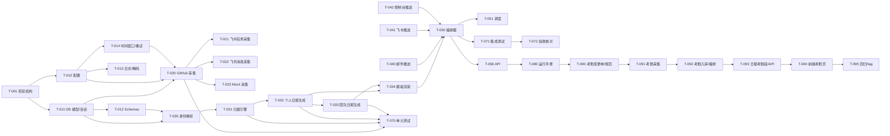

# 智能日报生成器 · 任务清单（tasks.md）

> 版本：v1.0
> 阶段：第 2 周 · 任务拆解
> 关联：[proposal.md](proposal.md)、[design.md](design.md)
> 粒度原则：一个任务 = 一个可验证的交付物；验收标准必须可执行。

## 1. 依赖图

## 2. 任务清单

### 阶段 A：项目结构

| 编号 | 标题 | 交付物 | 验收标准 | 依赖 | 预估 | 并行组 |
|------|------|--------|----------|------|------|--------|
| T-001 | 初始化 v1 工程结构 | `backend/app/{core,db,models,schemas,services,api}`、`frontend`、`specs`、`docs` | 目录存在；`uvicorn app.main:app` 可启动；`GET /api/health` 返回 200 | 无 | 0.5h | P0 |

### 阶段 B：共享基础层

| 编号 | 标题 | 交付物 | 验收标准 | 依赖 | 预估 | 并行组 |
|------|------|--------|----------|------|------|--------|
| T-010 | 配置管理 | `core/config.py`，读取 `.env`，含 GitHub/飞书/SMTP/MySQL 配置 | `get_settings()` 可加载；缺凭证时健康检查显示未就绪；不打印密钥 | T-001 | 0.5h | P1 |
| T-011 | 数据库模型与会话 | `db/base.py`、`db/session.py`、`models/entities.py` | 12 张表可 `create_all`；SQLite 测试库可建表；MySQL 连接串正确 | T-001 | 2h | P1 |
| T-012 | 请求/响应 Schemas | `schemas/*.py` | 日报列表/详情/编辑/生成/推送、成员绑定接口的入参校验可运行 | T-011 | 1h | P1 |
| T-013 | 日志与脱敏 | `core/logging.py` | 日志中 token/secret 被掩码；不输出 `.env` 内容 | T-010 | 0.5h | P1 |
| T-014 | 时间窗口与重试工具 | `core/timeutil.py`、`core/retry.py` | 自然日窗口按 Asia/Shanghai 计算并转 UTC；重试最多 3 次、指数退避 | T-010 | 1h | P1 |

### 阶段 C：三个采集模块

| 编号 | 标题 | 交付物 | 验收标准 | 依赖 | 预估 | 并行组 |
|------|------|--------|----------|------|------|--------|
| T-020 | GitHub 提交采集 | `services/collectors/github.py` | 指定仓库窗口内 commit 可采集；`(repo_id, sha)` 幂等；403/429 返回 partial 并重试 | T-010、T-011、T-014 | 2h | P2 |
| T-021 | 飞书任务采集 | `services/collectors/feishu_tasks.py` | 能获取 tenant token；任务按 `task_id` upsert；限流返回 partial | T-020 | 1.5h | P2 |
| T-022 | 飞书群消息采集 | `services/collectors/feishu_messages.py` | 仅采集配置的 chat_id；按 `message_id` 去重；内容截断/脱敏 | T-020 | 1.5h | P2 |
| T-023 | Mock 数据源 | `services/collectors/mock.py` | 不依赖外部凭证，能生成当天提交/任务/消息，供演示与测试 | T-020 | 0.5h | P2 |

### 阶段 D：生成层

| 编号 | 标题 | 交付物 | 验收标准 | 依赖 | 预估 | 并行组 |
|------|------|--------|----------|------|------|--------|
| T-030 | 成员身份解析 | `services/identity.py` | 邮箱/用户名可映射成员；未命中写入 `identity_unmatched`；重复不重复写 | T-011、T-012 | 1.5h | P3 |
| T-031 | 协作成果归属 | `services/attribution.py` | 按 author/reviewer/owner/participant 生成条目；按自然键去重 | T-030 | 1.5h | P3 |
| T-032 | 个人日报生成 | `services/reports/personal.py` | 四段式输出；无数据输出「无产出」；明日计划取未完成任务 | T-031 | 2h | P3 |
| T-033 | 团队日报生成 | `services/reports/team.py` | 四段式模板；含团队概览、成员摘要、协作成果、风险 | T-032 | 1.5h | P3 |
| T-034 | 日报模板渲染 | `services/reports/renderer.py` | 同一输入输出稳定；Markdown 可读 | T-032、T-033 | 0.5h | P3 |

### 阶段 E：推送层

| 编号 | 标题 | 交付物 | 验收标准 | 依赖 | 预估 | 并行组 |
|------|------|--------|----------|------|------|--------|
| T-040 | 邮件推送 | `services/pushers/email.py` | SMTP_SSL 465；失败重试 3 次并写 `push_logs` | T-010、T-011 | 1h | P4 |
| T-041 | 飞书机器人推送 | `services/pushers/feishu_bot.py` | 获取 tenant token 并发送到 chat；失败写日志 | T-010、T-011 | 1h | P4 |
| T-042 | 控制台/Mock 推送 | `services/pushers/console.py` | 不依赖外部服务，输出日报并可被测试断言 | T-010 | 0.3h | P4 |

### 阶段 F：主编排与调度

| 编号 | 标题 | 交付物 | 验收标准 | 依赖 | 预估 | 并行组 |
|------|------|--------|----------|------|------|--------|
| T-050 | 日报编排器 | `services/orchestrator.py` | 串联采集→生成→推送；重跑不重复；单数据源失败可降级 | T-020–T-042 | 3h | P5 |
| T-051 | 定时调度 | `scheduler.py` | 次日 09:00 触发前一自然日任务；单 worker 说明 | T-050 | 0.5h | P5 |

### 阶段 G：接口与测试

| 编号 | 标题 | 交付物 | 验收标准 | 依赖 | 预估 | 并行组 |
|------|------|--------|----------|------|------|--------|
| T-060 | REST API | `api/routes/*.py` | 日报查询/详情/编辑/生成/推送、成员与身份绑定、推送日志可用 | T-050 | 3h | P6 |
| T-070 | 单元测试 | `tests/test_*` | 归属、个人/团队生成、时间窗口测试通过 | T-020–T-034 | 2h | P7 |
| T-071 | 集成测试 | `tests/test_integration.py` | 用 Mock 采集 + SQLite 跑通采集→生成→推送；重复运行不重复 | T-050 | 2h | P7 |
| T-072 | 成功标准核对 | `docs/验收核对表.md` | 对照 proposal F/P/B 逐条记录通过/未通过 | T-071 | 1h | P8 |
| T-080 | 运行手册 | `README.md`、`docs/运行手册.md` | 建库、配置、启动、演示、测试步骤可复现 | T-060 | 1h | P8 |

### 阶段 I：第 4 周变更单（考勤采集，实施在 v2）

| 编号 | 标题 | 交付物 | 验收标准 | 依赖 | 预估 | 并行组 |
|------|------|--------|----------|------|------|--------|
| T-090 | 考勤变更单与规范同步 | 变更单、确认记录、proposal/design/tasks/UML 同步 | 变更单与规范逐条一致 | T-080 | 2h | P9 |
| T-091 | 考勤采集器 | `services/collectors/attendance.py` | Mock/真实两条路径；按成员+日期聚合；限流 partial | T-014 | 2h | P9 |
| T-092 | 考勤入库与编排 | `models/entities.py`、`services/orchestrator.py` | `(member_id, attendance_date)` 幂等；未归属写未匹配表 | T-050、T-091 | 2h | P9 |
| T-093 | 日报考勤段与 API | `reports/personal.py`、`team.py`、`api/routes/attendance.py` | 个人五段式；团队汇总；`GET /api/attendance` | T-092 | 2h | P9 |
| T-094 | 前端考勤页 | `AttendanceView.vue`、路由/导航 | 按日期查看；member 只看本人 | T-093 | 1.5h | P9 |
| T-095 | 全量回归与 tag | 测试、验收表、tag `v2-superpowers` | 旧 65 项 + 新增考勤测试全绿 | T-094 | 2h | P9 |

## 3. 并行组说明

- **P1**：配置、模型、时间工具可并行；
- **P2**：三个采集模块互不共享文件，可并行；Mock 采集作为无凭证兜底；
- **P3**：身份解析必须先于归属；归属之后个人/团队生成可并行；
- **P4**：三个 Pusher 互相独立，可并行；
- **P5**：编排器依赖全部采集与推送，必须串行；
- **P6/P7/P8**：API 完成后再做集成测试与验收核对。
- **P9**：第 4 周考勤变更单，按规范 → 采集 → 入库/编排 → 日报/API → 前端 → 回归串行推进。

## 4. 提交约定

- 一次提交对应一个任务，message 格式：`feat|fix|test|docs: [T-编号] 一句话说明`；
- 合并前执行 code-review 工作流；
- 每个任务完成后在本表勾选并记录验收证据。
