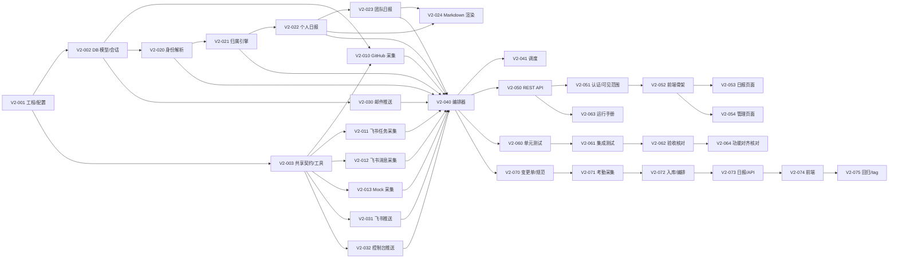

# v2 智能日报生成器 · 任务清单（tasks）

> 版本：v2.0
> 阶段：第 3–4 周 · Superpowers 工作流驱动
> 关联：`03-v2设计输入.md`（需求与设计结论）、`02-v2初始化记录.md`（纪律与完成定义）
> 粒度原则：一个任务 = 一个可验证的交付物；先写失败测试，再实现，再重构。
> 提交格式：`feat|fix|test|docs: [V2-xxx] 一句话说明`

## 1. 依赖图



## 2. 任务总表

### 阶段 A：项目结构

| 编号 | 标题 | 交付物 | 验收标准 | 依赖 | 预估 | 并行组 |
|------|------|--------|----------|------|------|--------|
| V2-001 | 工程与配置 | `core/config.py`、`requirements*.txt`、`.env.example` | `uvicorn app.main:app` 可启动；`GET /api/health` 200；缺凭证不报错；数据库默认 `daily_report_v2` | 无 | 0.5h | P0 |
| V2-002 | 数据库模型与会话 | `db/base.py`、`db/session.py`、`models/entities.py`、`sql/schema.sql` | 13 张表可建；SQLite 测试库可建表；幂等唯一键存在 | V2-001 | 2.5h | P1 |
| V2-003 | 共享契约与工具 | `core/timeutil.py`、`core/contracts.py`、`core/retry.py`、`core/logging.py` | 自然日窗口正确；跨零点归属正确；`SourceError` 可序列化；重试 3 次；日志掩码 | V2-001 | 1.5h | P1 |

### 阶段 B：采集层

| 编号 | 标题 | 交付物 | 验收标准 | 依赖 | 预估 | 并行组 |
|------|------|--------|----------|------|------|--------|
| V2-010 | GitHub 采集 | `services/collectors/github.py` | 窗口内 commit 全覆盖；`(repo_id, sha)` 幂等；403/429 partial + 重试；超时 15s | V2-002、V2-003 | 2.5h | P2 |
| V2-011 | 飞书任务采集 | `services/collectors/feishu_tasks.py` | 能取 tenant token；按 `task_id` upsert；限流 partial | V2-003 | 1.5h | P2 |
| V2-012 | 飞书消息采集 | `services/collectors/feishu_messages.py` | 仅配置 `chat_id`；按 `message_id` 去重；内容截断 500 字并脱敏 | V2-003 | 1.5h | P2 |
| V2-013 | Mock 采集 | `services/collectors/mock.py` | 无凭证生成当天提交/任务/消息；字段与真实采集器一致 | V2-003 | 0.5h | P2 |

### 阶段 C：生成层

| 编号 | 标题 | 交付物 | 验收标准 | 依赖 | 预估 | 并行组 |
|------|------|--------|----------|------|------|--------|
| V2-020 | 身份解析 | `services/identity.py` | 邮箱/用户名可映射；未命中写 `identity_unmatched`；重复不重复写 | V2-002 | 1.5h | P3 |
| V2-021 | 协作归属 | `services/attribution.py` | author/reviewer/owner/participant 生成条目；自然键去重；不重复计数 | V2-020 | 1.5h | P3 |
| V2-022 | 个人日报 | `services/reports/personal.py` | 四段式；无数据「无产出」；明日计划取未完成任务；稳定排序 | V2-021 | 2h | P3 |
| V2-023 | 团队日报 | `services/reports/team.py` | 四段式；团队概览/成员摘要/协作成果/风险；跨成员去重 | V2-022 | 1.5h | P3 |
| V2-024 | Markdown 渲染 | `services/reports/renderer.py` | 同输入同输出；标题/列表/空态可读 | V2-022、V2-023 | 0.5h | P3 |

### 阶段 D：推送层

| 编号 | 标题 | 交付物 | 验收标准 | 依赖 | 预估 | 并行组 |
|------|------|--------|----------|------|------|--------|
| V2-030 | 邮件推送 | `services/pushers/email.py` | SMTP_SSL 465；失败重试 3 次；每次写 `push_logs` | V2-002 | 1h | P4 |
| V2-031 | 飞书机器人推送 | `services/pushers/feishu_bot.py` | 取 tenant token 并发送；失败写日志；Mock 模式跳过 | V2-003 | 1h | P4 |
| V2-032 | 控制台推送 | `services/pushers/console.py` | 不依赖外部服务；输出可被测试断言 | V2-003 | 0.3h | P4 |

### 阶段 E：编排与调度

| 编号 | 标题 | 交付物 | 验收标准 | 依赖 | 预估 | 并行组 |
|------|------|--------|----------|------|------|--------|
| V2-040 | 日报编排器 | `services/orchestrator.py` | 串联采集→生成→推送；重跑不重复；单源失败降级；更新同步状态 | V2-010–V2-032 | 3h | P5 |
| V2-041 | 定时调度 | `scheduler.py` | 次日 09:00 触发前一自然日；单 worker 说明 | V2-040 | 0.5h | P5 |

### 阶段 F：接口与前端

| 编号 | 标题 | 交付物 | 验收标准 | 依赖 | 预估 | 并行组 |
|------|------|--------|----------|------|------|--------|
| V2-050 | REST API | `api/routes/*.py`、`schemas/*.py` | 日报查询/详情/编辑/生成/推送、成员/身份绑定、数据源状态、推送日志可用 | V2-040 | 3h | P6 |
| V2-051 | 认证与可见范围 | `services/auth.py`、`api/routes/auth.py` | admin/leader/member 三级；匿名 401；越权 403；member 只见团队 + 本人 | V2-050 | 2h | P6 |
| V2-052 | 前端骨架 | `frontend/src/{router,stores,api}` | 登录、路由守卫、按角色导航 | V2-051 | 1.5h | P7 |
| V2-053 | 日报页面 | `ReportsView.vue`、`ReportDetailView.vue` | 列表筛选、详情、编辑、导出 Markdown | V2-052 | 2.5h | P7 |
| V2-054 | 管理页面 | `SourcesView.vue`、`PushView.vue`、`IdentitiesView.vue` | 数据源状态、推送记录、未归属身份绑定 | V2-052 | 2h | P7 |

### 阶段 G：测试与交付

| 编号 | 标题 | 交付物 | 验收标准 | 依赖 | 预估 | 并行组 |
|------|------|--------|----------|------|------|--------|
| V2-060 | 单元测试 | `tests/test_*` | 归属、个人/团队生成、时间窗口、幂等、降级测试通过 | V2-040 | 2h | P8 |
| V2-061 | 集成测试 | `tests/test_integration.py` | Mock 采集 + 测试库跑通采集→生成→推送；重复运行不重复 | V2-060 | 2h | P8 |
| V2-062 | 验收核对 | `docs/验收核对表.md` | 对照 F/P/B 逐条记录通过/未通过 | V2-061 | 1h | P8 |
| V2-063 | 运行手册 | `README.md`、`docs/运行手册.md` | 建库、配置、启动、演示、测试可复现 | V2-050 | 1h | P8 |
| V2-064 | 功能对齐核对 | `docs/功能对齐表.md` | 对照 v1 实际功能列出差异与补齐决定 | V2-062 | 1h | P8 |

### 阶段 H：第 4 周变更涟漪（考勤采集）

| 编号 | 标题 | 交付物 | 验收标准 | 依赖 | 预估 | 并行组 |
|------|------|--------|----------|------|------|--------|
| V2-070 | 变更单与规范同步 | 变更单、确认记录、specs、v2 docs | 变更单与规范逐条一致 | V2-064 | 2h | P9 |
| V2-071 | 考勤采集器 | `services/collectors/attendance.py` | Mock/真实两条路径；按成员+日期聚合；限流 partial | V2-003 | 2h | P9 |
| V2-072 | 考勤入库与编排 | `models/entities.py`、`services/orchestrator.py` | `(member_id, attendance_date)` 幂等；未归属写未匹配表 | V2-040、V2-071 | 2h | P9 |
| V2-073 | 日报考勤段与 API | `reports/personal.py`、`team.py`、`api/routes/attendance.py` | 个人五段式；团队汇总；`GET /api/attendance` | V2-072 | 2h | P9 |
| V2-074 | 前端考勤页 | `AttendanceView.vue`、路由/导航 | 按日期查看；member 只看本人 | V2-073 | 1.5h | P9 |
| V2-075 | 全量回归与 tag | 测试、验收表、tag `v2-superpowers` | 旧 65 项 + 新增考勤测试全绿 | V2-074 | 2h | P9 |

## 3. 并行组说明

- **P0**：工程与配置，最先做；
- **P1**：DB 模型与会话、共享契约可并行；
- **P2**：三个真实采集器 + Mock 互不共享文件，可并行；建议用子智能体分别执行，但 `contracts.py` 必须先冻结；
- **P3**：身份解析 → 归属必须串行；归属之后个人/团队生成可并行；渲染依赖两者；
- **P4**：三个 Pusher 互相独立，可并行；
- **P5**：编排器依赖全部采集、生成、推送，必须串行；调度依赖编排器；
- **P6**：API 完成后做认证；认证是共享横切面，串行；
- **P7**：前端骨架完成后，日报页面与管理页面可并行；
- **P8**：测试、验收、文档按顺序收口；
- **P9**：第 4 周变更单到达后再启动，不提前实现。

## 4. TDD 执行模板（每个任务照此执行）

以 `V2-003` 为例：

- [ ] **Step 1 写失败测试**：在 `tests/test_timeutil.py` 写 `test_day_window_cross_midnight`，断言 `day_window(date(2026,11,6))` 的 `start/end` 为上海时区自然日并转 UTC；
- [ ] **Step 2 运行并确认失败**：`pytest tests/test_timeutil.py::test_day_window_cross_midnight -v`，期望 `ImportError / AttributeError`；
- [ ] **Step 3 写最小实现**：在 `app/core/timeutil.py` 实现 `day_window(report_date: date) -> TimeWindow`；
- [ ] **Step 4 运行并确认通过**：同一命令，期望 `PASS`；
- [ ] **Step 5 重构**：消除重复、补类型注解，再跑一次；
- [ ] **Step 6 静态检查**：`ruff check .` 清零；
- [ ] **Step 7 提交**：`git add ... && git commit -m "feat: [V2-003] 增加时间窗口与错误契约"`。

**硬性规则**：
- 禁止先写实现再补测试；
- 测试必须能在实现前失败，且失败原因正确；
- 共享文件（`orchestrator.py`、`main.py`、`api/routes/__init__.py`）同一时间只允许一个执行者修改；
- 每个任务完成后在本表勾选，并在 `docs/验收核对表.md` 记录证据。

## 5. 每个任务的关键测试点

| 编号 | 必写测试（示例名） |
|------|--------------------|
| V2-001 | `test_health_ok`、`test_settings_db_name_default` |
| V2-002 | `test_create_all_tables`、`test_report_unique_key`、`test_commit_idempotency_key` |
| V2-003 | `test_day_window_cross_midnight`、`test_collection_result_partial`、`test_mask_token` |
| V2-010 | `test_github_collect_window`、`test_github_dedup_by_sha`、`test_github_rate_limit_partial` |
| V2-011 | `test_feishu_task_upsert`、`test_feishu_task_rate_limit_partial` |
| V2-012 | `test_feishu_message_chat_filter`、`test_message_content_truncated` |
| V2-013 | `test_mock_collect_without_credentials` |
| V2-020 | `test_resolve_by_email`、`test_unmatched_written_once` |
| V2-021 | `test_attribution_roles`、`test_attribution_dedup` |
| V2-022 | `test_personal_report_sections`、`test_no_data_outputs_no_output` |
| V2-023 | `test_team_report_sections`、`test_team_dedup_across_members` |
| V2-024 | `test_render_stable_output` |
| V2-030 | `test_email_push_writes_log`、`test_email_retry_on_failure` |
| V2-031 | `test_feishu_push_skipped_in_mock` |
| V2-032 | `test_console_push_output` |
| V2-040 | `test_orchestrator_end_to_end`、`test_orchestrator_rerun_idempotent`、`test_orchestrator_partial_source` |
| V2-041 | `test_scheduler_job_registered` |
| V2-050 | `test_reports_list`、`test_report_detail`、`test_edit_creates_version` |
| V2-051 | `test_anonymous_401`、`test_member_forbidden_admin_api`、`test_member_sees_own_and_team` |
| V2-052 | 前端构建 `npm run build` 通过 |
| V2-053 | 前端构建通过；手工验收列表/详情/编辑 |
| V2-054 | 前端构建通过；手工验收状态/日志/绑定 |
| V2-060 | `pytest -q` 全绿 |
| V2-061 | `test_integration_pipeline`、`test_integration_rerun` |
| V2-062 | 验收表逐条勾选 |
| V2-063 | 按 README 从零可跑通 |
| V2-064 | 功能对齐表逐条勾选 |
| V2-070 | `test_attendance_collect`、`test_report_contains_attendance` |
| V2-071 | `pytest -q` 全绿 |
| V2-072 | 规范审计表 + tag 存在 |

## 6. 代码评审节点

| 节点 | 范围 | 输出 |
|------|------|------|
| R1 | V2-001–V2-003 | 共享层评审：配置、模型、契约、时间窗口 |
| R2 | V2-010–V2-013 | 采集层评审：幂等、重试、降级、脱敏 |
| R3 | V2-020–V2-024 | 生成层评审：归属规则、四段式、稳定排序 |
| R4 | V2-030–V2-041 | 推送与编排评审：重试、锁、幂等、事务 |
| R5 | V2-050–V2-054 | API 与前端评审：权限、可见范围、错误码 |
| R6 | V2-060–V2-064 | 交付评审：测试覆盖、验收证据、文档一致性 |
| R7 | V2-070–V2-072 | 变更涟漪评审：规范同步、回归、tag |

评审意见必须逐条回应或修复；未回应的意见不得进入下一阶段。

## 7. 执行进度（第 3 周）

> 状态：✅ 完成　⚠️ 部分　⬜ 未开始
> 每个任务对应一次提交；测试与验证命令见“证据”列。

| 任务 | 状态 | 证据 |
|------|------|------|
| V2-001 工程与配置 | ✅ | `ce930eb`；`test_config.py` |
| V2-002 数据库模型与会话 | ✅ | `710bc9b`；`test_models.py` 3 项 |
| V2-003 共享契约与工具 | ✅ | `e78b7df`；`test_timeutil/contracts/logging/retry` 8 项 |
| V2-010 GitHub 采集 | ✅ | `4e86094`；`test_github_collector.py` 4 项 |
| V2-011 飞书任务采集 | ✅ | `afd7962`；`test_feishu_tasks.py` 4 项 |
| V2-012 飞书消息采集 | ✅ | `82684d7`；`test_feishu_messages.py` 5 项 |
| V2-013 Mock 采集 | ✅ | `f2f339b`；`test_mock_collector.py` 3 项 |
| V2-020 身份解析 | ✅ | `56621b1`；`test_identity.py` 4 项 |
| V2-021 协作归属 | ✅ | `a739853`；`test_attribution.py` 3 项 |
| V2-022 个人日报 | ✅ | `b6323a3`；`test_personal_report.py` 3 项 |
| V2-023 团队日报 | ✅ | `f27302d`；`test_team_report.py` 3 项 |
| V2-024 Markdown 渲染 | ✅ | `94efc89`；`test_renderer.py` |
| V2-030 邮件推送 | ✅ | `91b09d0`；`test_email_pusher.py` 3 项 |
| V2-031 飞书机器人推送 | ✅ | `6119610`；`test_feishu_pusher.py` 2 项 |
| V2-032 控制台推送 | ✅ | `3d459df`；`test_console_pusher.py` |
| V2-040 编排器 | ✅ | `edeca0e`；`test_orchestrator.py` 3 项 |
| V2-041 定时调度 | ✅ | `eae754e`；`test_scheduler.py` |
| V2-050 REST API | ✅ | `d63059f`；`test_api.py` 5 项 |
| V2-051 认证与可见范围 | ✅ | `f12483e`；`test_auth.py` 5 项 |
| V2-052 前端骨架 | ✅ | `72d2fb2`；`npm run build` 通过 |
| V2-053 日报页面 | ✅ | `bf33b9e`；构建通过 + API 联调 |
| V2-054 管理页面 | ✅ | `50e754c`；构建通过 |
| V2-060 单元测试 | ✅ | 随各任务提交；`pytest -q` → 65 passed |
| V2-061 集成测试 | ✅ | `test_orchestrator_end_to_end`、`test_orchestrator_rerun_idempotent` |
| V2-062 验收核对 | ✅ | `docs/验收核对表.md`；3 人端到端 0.088s |
| V2-063 运行手册 | ✅ | `v2-superpowers/README.md` |
| V2-064 功能对齐核对 | ✅ | `docs/功能对齐表.md` |
| V2-070 变更单与规范同步 | ⬜ | 变更单 06/07/08 + specs + v2 docs |
| V2-071 考勤采集器 | ⬜ | `collectors/attendance.py` |
| V2-072 考勤入库与编排 | ⬜ | `attendance_records` + orchestrator |
| V2-073 日报考勤段与 API | ⬜ | 五段式 + `/api/attendance` |
| V2-074 前端考勤页 | ⬜ | `AttendanceView.vue` |
| V2-075 全量回归与 tag | ⬜ | 回归 + `v2-superpowers` tag |

**当前验证命令**：

```bash
cd v2-superpowers/backend
pytest -q          # 65 passed
ruff check .       # All checks passed

cd ../frontend
npm run build      # 成功

# 后端运行在 8001 时
cd ../backend
python -m scripts.verify_e2e http://127.0.0.1:8001/api
```

